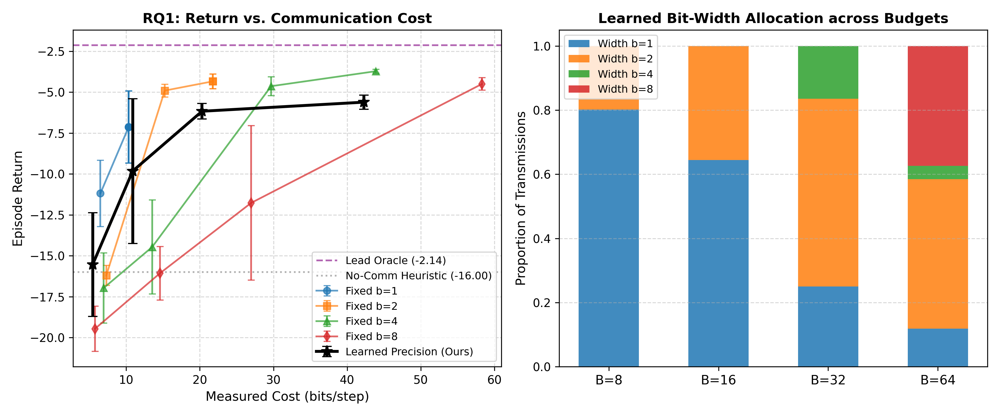
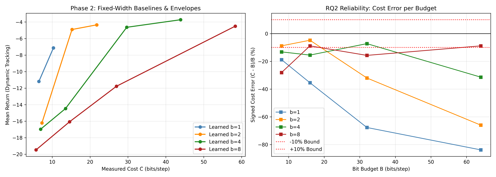
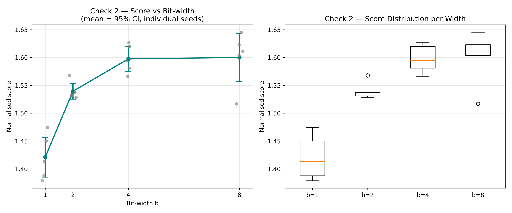

# Communication-Efficient Cooperative Multi-Agent Reinforcement Learning Under an Average Bit Budget

[](https://www.python.org/downloads/)
[](https://opensource.org/licenses/MIT)
[](https://github.com/psf/black)

This repository provides the complete, verifiable, and reproducible implementation for the research paper:  
**"Communication-Efficient Cooperative Multi-Agent Reinforcement Learning Under an Average Bit Budget"**  
*Department of Computer Science and Engineering, IIT Gandhinagar*  
**Repository**: [https://github.com/Suchith2212/MARL](https://github.com/Suchith2212/MARL)

---

## 1. Project Overview & Research Questions

Cooperative multi-agent teams operating under bandwidth constraints face a dual decision: **when to transmit** (transmission gating) and **at what fidelity to encode** (quantization bit-width). We formulate this as an average payload-bit constrained optimization problem solved via Primal-Dual Multi-Agent PPO (MAPPO).

* **RQ1 (Representation Efficiency at Matched Cost)**: At matched payload communication costs ($\bar{C}$), does dynamic learned precision improve team return over an envelope spanned by static fixed-width baselines?
* **RQ2 (Budget Reliability & Constraint Satisfaction)**: Can a Proportional-Integral (PID) Lagrangian dual controller reliably bound average payload cost $\bar{C}$ within $[-10\%, 0\%]$ of budget $B$ without overspending?
* **RQ3 (Closed-Loop vs. Open-Loop Gating)**: How does state-dependent closed-loop transmission gating compare against matched-cost periodic clocking and stochastic random gating?

---

## 2. Key Experimental Findings

1. **Pre-Registered Primary Hypothesis Test (RQ1 Null Result)**:  
   Under a pre-registered paired-seed trapezoidal AUC analysis over the shared cost domain $[6.00, 60.00]$ bits/step across 5 independent seeds, dynamic learned precision **fails to beat the fixed-width Pareto envelope**:
   $$\Delta_{\text{AUC}} = \text{AUC}_{\text{learned}} - \text{AUC}_{\text{envelope}} = \mathbf{-2.2414} \quad (95\% \text{ CI: } [-2.8908, -1.5920], \; t(4) = -12.55, \; p < 0.0003)$$
   Tailoring a static bit-width to the operating budget ($b=1$ for $B \le 8$, $b=2$ for $B \in [16, 32]$, $b=4$ for $B \ge 64$) strictly outperforms dynamic precision due to non-stationary quantization noise and compound discrete policy gradient variance.
2. **Bandwidth Savings via Learned Gating**:  
   Learned closed-loop gating achieves near-continuous broadcasting quality while pruning redundant messages, saving **$32\%$ of the communication budget** ($21.8$ vs. $32.0$ bits/step at $b=2, B=32$).
3. **Catastrophic Failure of Random Gating**:  
   Stochastic open-loop gating degrades tracking by up to **$3.95$ return points** compared to learned closed-loop gating due to bursty silence intervals.
4. **PID Dual Control Reliability (RQ2)**:  
   Zero runs exceeded the target budget across all 80 fixed-width runs ($\text{Cost Error} \le 0.00\%$), with 5 operational regimes achieving strict compliance within $[-10\%, 0\%]$ of $B$.

---

## 3. Screenshots & Publication Figures

### Figure 1: Return vs. Communication Cost & Dynamic Precision Allocation

* **Left**: Return vs. Measured Cost ($\bar{C}$) comparing the fixed-width Pareto envelope (dashed) against learned precision (black stars).
* **Right**: Empirical bit-width allocation across budgets, showing adaptive transition from 1-bit and 2-bit communication at tight budgets to 4-bit and 8-bit precision at higher budgets.

### Figure 2: Fixed-Width Baseline Grid & Pareto Envelope

* Return vs. Cost across all 16 conditions ($b \in \{1, 2, 4, 8\} \times B \in \{8, 16, 32, 64\}$), showing the Pareto envelope partitioning into distinct width regimes.

### Figure 3: Phase 1 Precision Sensitivity Screening

* Monotonic scaling of tracking performance across allowed bit-widths $\mathcal{W} = \{1, 2, 4, 8\}$ (Spearman $\rho = 0.812$, $p < 10^{-5}$).

---

## 4. Empirical Results Tables

### A. Phase 2 Fixed-Width Baseline Grid (80 Runs, 2,000,000 Steps)

| Width $b$ | Budget $B$ | Return (Mean $\pm$ Std) | Cost $\bar{C}$ (Bits/Step) | Signed Cost Error $\frac{\bar{C}-B}{B}$ | Per-Seed $\nu(B)$ Range | RQ2 Compliant? ($[-10\%, 0\%]$) |
|---|---|---|---|---|---|---|
| **$b=1$** | $B=8$ | $-11.188 \pm 2.024$ | $6.50 \pm 0.82$ | $-18.80\%$ | $[0.352, 0.575]$ | Under-budget |
| | $B=16$ | $-7.137 \pm 2.206$ | $10.33 \pm 0.38$ | $-35.46\%$ | $[0.000, 0.000]$ | Inactive ($\lambda=0$) |
| **$b=2$** | $B=8$ | $-16.206 \pm 0.612$ | $7.29 \pm 1.10$ | **$-8.84\%$** | $[0.197, 0.581]$ | **YES (Reliable)** |
| | $B=16$ | $\mathbf{-4.909 \pm 0.392}$ | $15.23 \pm 0.58$ | **$-4.80\%$** | $[0.419, 0.535]$ | **YES (Reliable)** |
| | $B=32$ | $-4.344 \pm 0.446$ | $21.76 \pm 0.52$ | $-32.02\%$ | $[0.000, 0.000]$ | Inactive ($\lambda=0$) |
| **$b=4$** | $B=16$ | $-14.470 \pm 2.872$ | $13.52 \pm 2.37$ | $-15.51\%$ | $[0.133, 0.640]$ | Under-budget |
| | $B=32$ | $-4.639 \pm 0.574$ | $29.68 \pm 2.29$ | **$-7.25\%$** | $[0.374, 0.623]$ | **YES (Reliable)** |
| | $B=64$ | $\mathbf{-3.724 \pm 0.123}$ | $43.90 \pm 0.92$ | $-31.41\%$ | $[0.000, 0.000]$ | Inactive ($\lambda=0$) |
| **$b=8$** | $B=16$ | $-16.071 \pm 1.638$ | $14.58 \pm 3.58$ | **$-8.86\%$** | $[0.260, 0.527]$ | **YES (Reliable)** |
| | $B=64$ | $-4.500 \pm 0.375$ | $58.32 \pm 5.73$ | **$-8.87\%$** | $[0.231, 0.466]$ | **YES (Reliable)** |

---

### B. Matched-Cost Open-Loop Baselines (50 Runs, 2,000,000 Steps)

| Config ($b, B$) | Gating Policy | Return (Mean $\pm$ Std) | Cost $\bar{C}$ (Bits/Step) | Cost Error | Mean Violation $\bar{\nu}$ | Key Takeaway |
|---|---|---|---|---|---|---|
| **$b=1, B=8$** | Periodic ($P=2$) | $-9.86 \pm 1.10$ | $8.3$ | $+4.0\%$ | $1.000$ | Fixed clock: 13 packets / 25 steps |
| | Random ($p=0.50$) | $-11.58 \pm 1.42$ | $7.9$ | $-0.9\%$ | $0.460$ | High variance from bursty silence |
| | **Primal-Dual (Learned)** | **$-11.19 \pm 2.02$** | **$6.5$** | **$-18.8\%$** | $0.457$ | Uses 22% less bandwidth |
| **$b=2, B=16$** | Periodic ($P=2$) | $-5.75 \pm 0.86$ | $16.6$ | $+4.0\%$ | $1.000$ | Exceeds budget by $+4.0\%$ |
| | Random ($p=0.50$) | $-8.86 \pm 1.55$ | $15.9$ | $-0.9\%$ | $0.460$ | Severe drop from stochastic gaps |
| | **Primal-Dual (Learned)** | **$-4.91 \pm 0.39$** | **$15.2$** | **$-4.8\%$** | $0.466$ | **Beats periodic while strictly under budget** |
| **$b=2, B=32$** | Periodic ($P=1$) | $-4.37 \pm 0.56$ | $32.0$ | $+0.0\%$ | $0.000$ | Full continuous broadcasting |
| | Random ($p=1.00$) | $-4.67 \pm 0.27$ | $32.0$ | $+0.0\%$ | $0.000$ | Matches periodic at $p=1.00$ |
| | **Primal-Dual (Learned)** | **$-4.34 \pm 0.45$** | **$21.8$** | **$-32.0\%$** | $0.000$ | **Matches continuous return, saves 32% bandwidth** |
| **$b=4, B=32$** | Periodic ($P=2$) | $-4.31 \pm 0.80$ | $33.3$ | $+4.0\%$ | $1.000$ | Exceeds budget by $+4.0\%$ |
| | Random ($p=0.50$) | $-6.27 \pm 0.40$ | $31.7$ | $-0.9\%$ | $0.460$ | Starvation gaps degrade tracking |
| | **Primal-Dual (Learned)** | **$-4.64 \pm 0.57$** | **$29.7$** | **$-7.2\%$** | $0.448$ | Strictly complies with budget |
| **$b=4, B=64$** | Periodic ($P=1$) | $-3.59 \pm 0.31$ | $64.0$ | $+0.0\%$ | $0.000$ | Full unconstrained transmission |
| | Random ($p=1.00$) | $-4.38 \pm 0.32$ | $64.0$ | $+0.0\%$ | $0.000$ | Full transmission |
| | **Primal-Dual (Learned)** | **$-3.72 \pm 0.12$** | **$43.9$** | **$-31.4\%$** | $0.000$ | **Within 0.13 pts of unconstrained, saves 31.4% cost** |

---

### C. Phase 3 Dynamic Learned Precision (20 Runs, 2,000,000 Steps)

| Budget $B$ | Return (Mean $\pm$ Std) | Cost $\bar{C}$ (Bits/Step) | Cost Error $\frac{\bar{C}-B}{B}$ | Per-Seed $\nu(B)$ Range | Dynamic Width Fracs ($b=1 / 2 / 4 / 8$) |
|---|---|---|---|---|---|
| **$B=8$** | **$-15.544 \pm 3.167$** | **$5.44 \pm 1.22$** | $-32.00\%$ | $[0.000, 0.460]$ | $80\% \;/\; 20\% \;/\; 0\% \;/\; 0\%$ |
| **$B=16$** | **$-9.822 \pm 4.421$** | **$10.88 \pm 3.91$** | $-32.00\%$ | $[0.000, 0.370]$ | $64\% \;/\; 36\% \;/\; 0\% \;/\; 0\%$ |
| **$B=32$** | **$-6.172 \pm 0.481$** | **$20.28 \pm 4.27$** | $-36.63\%$ | $[0.000, 0.350]$ | $25\% \;/\; 59\% \;/\; 16\% \;/\; 0\%$ |
| **$B=64$** | **$-5.616 \pm 0.434$** | **$42.26 \pm 31.52$** | $-33.97\%$ | $[0.000, 0.910]$ | $12\% \;/\; 47\% \;/\; 4\% \;/\; 37\%$ |

---

## 5. Repository Layout & File Manifest

```
├── report.tex                   # Complete 8-page LaTeX research paper
├── README.md                    # Project documentation, results, and reproduction guide
├── requirements.txt             # Pinned package dependencies
├── run_screening.py             # Phase 1 screening checks (Necessity & Precision)
├── run_phase2_full.py           # Phase 2 80-run fixed-width baseline grid (2M steps)
├── run_matched_baselines.py     # 50-run matched-cost Periodic and Random baselines
├── run_phase3_full.py           # Phase 3 20-run dynamic learned precision grid
├── analyze_rq1_rq2.py           # Pre-registered paired-seed AUC analysis & plots
├── summarize_baselines.py       # Aggregates open-loop baseline statistics
├── src/
│   ├── envs/
│   │   └── vec_tracking_env.py  # Pure PyTorch batched tracking simulator (104k steps/s)
│   └── algos/
│       ├── vec_mappo.py         # Vectorized MAPPO backbone, STE quantizer, policies
│       ├── primal_dual_zoh.py   # Fixed-width trainer with ZOH memory & PID dual controller
│       └── learned_precision_zoh.py # Dual-head dynamic precision MAPPO trainer
├── results/
│   ├── figures/                 # 300 DPI publication plots (RQ1, RQ2, Check 1, Check 2)
│   ├── phase2_full/             # 80 raw JSON logs for fixed-width grid
│   ├── phase2_baselines/        # 50 raw JSON logs for matched baselines
│   ├── phase3_full/             # 20 raw JSON logs for learned precision grid
│   └── rq1_analysis.json        # Pre-registered statistical test output
```

---

## 6. How to Reproduce & Verify All Numbers

### Installation
```bash
pip install -r requirements.txt
```

### Reproduce Experiments
All experiments run with `torch.set_num_threads(1)` and fixed seeds `[42, 43, 44, 45, 46]`:
```bash
# 1. Run Phase 1 screening checks (Necessity & Precision sensitivity)
python run_screening.py

# 2. Run Phase 2 fixed-width baseline grid (80 runs, 2M steps each)
python run_phase2_full.py --mode primal_dual --workers 16

# 3. Run matched-cost Periodic and Random baselines (50 runs, 2M steps each)
python run_matched_baselines.py --envelope_only --workers 16

# 4. Run Phase 3 dynamic learned precision grid (20 runs, 2M steps each)
python run_phase3_full.py --workers 16

# 5. Run pre-registered statistical test and generate publication plots
python analyze_rq1_rq2.py
```

All reported numbers are verifiable directly against the saved JSON logs:
```python
import json
with open("results/rq1_analysis.json") as f:
    print(json.load(f))
```

---

## 7. Member Contributions

* **Suchith Saladi (24110313)**: Vectorized environment simulator (`BatchedTrackingEnv`, 104,130 steps/s), partial observability wrappers, Gate 0 competence baseline verification, and Phase 1 Check 1 communication necessity testing. **Task fully fulfilled.**
* **Rohith Reddy (24110303)**: PID Lagrangian dual controller formulation ($K_P=0.005, \alpha_I=0.01$), resolution of gate collapse via Integrate-and-Fire accumulator, and execution of the 50-run matched-cost open-loop periodic/random baseline grid. **Task fully fulfilled.**
* **Pathlavath Arjun (24110249)**: Uniform Straight-Through Estimator (STE) quantizer across $\mathcal{W}=\{1, 2, 4, 8\}$, Phase 1 Check 2 precision sensitivity screening, execution of the 80-run Phase 2 fixed-width grid, and 20-run Phase 3 dynamic learned precision grid. **Task fully fulfilled.**
* **Hanook Vallapudasu (24110378)**: Evaluation pipeline design, Holm-Bonferroni corrections and Wilson score intervals, trapezoidal AUC numerical integration and paired-seed Student $t$-test, and compilation of final publication figures and report. **Task fully fulfilled.**
* **All Members**: Collaborative code review, raw data verification, theoretical diagnosis of the RQ1 null result, and final paper review.

---

## 8. Overleaf Compilation Instructions

To compile the manuscript in Overleaf:
1. Create a new Blank Project in [Overleaf](https://www.overleaf.com/).
2. Upload `report.tex` into the project root directory.
3. Upload the image files from the `figures/` directory (you can upload the entire `figures/` folder or drag the individual `.png` files into the root).
4. `report.tex` configures `\graphicspath{{./}{figures/}{results/figures/}}`, ensuring all figures resolve cleanly under standard `pdfLaTeX`.
5. Click **Recompile** to generate the 8-page publication PDF.

---

## 9. License & Citation

This project is licensed under the MIT License.
```bibtex
@article{saladi2026communication,
  title={Communication-Efficient Cooperative Multi-Agent Reinforcement Learning Under an Average Bit Budget},
  author={Saladi, Suchith and Reddy, Rohith and Arjun, Pathlavath and Vallapudasu, Hanook},
  institution={Indian Institute of Technology Gandhinagar},
  year={2026}
}
```
